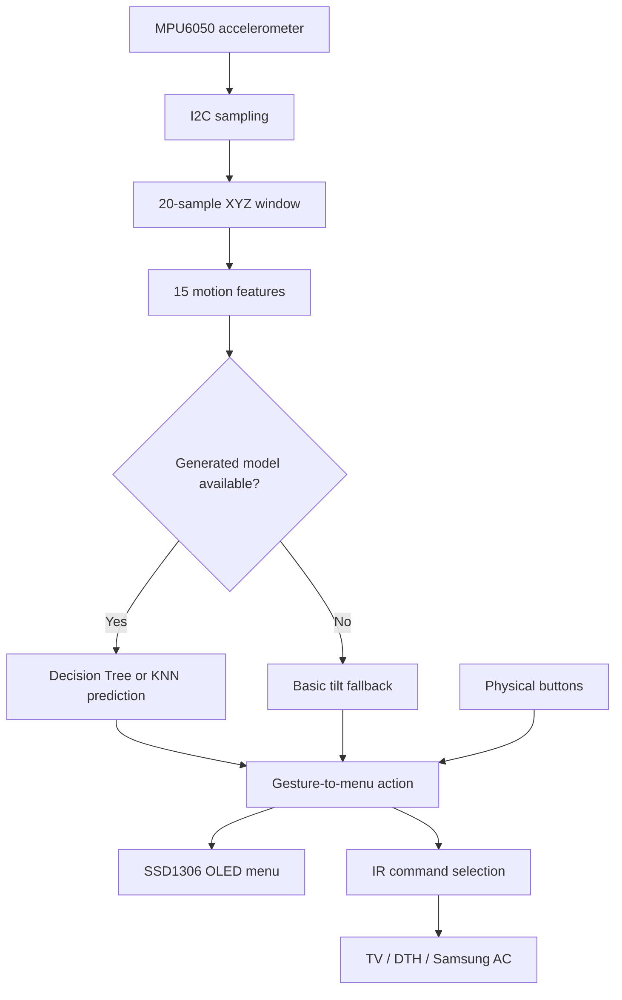

# Firmware Architecture

This document describes the implementation currently present in `firmware/gesture_remote/gesture_remote.ino`. It is intended to help contributors understand the code before modifying it.

## High-level data flow

## Firmware modules

### 1. Hardware setup

The firmware configures the ESP32 pins and initializes the I2C bus, SSD1306 display, IR transmitter and Samsung AC encoder.

| Function or constant | Purpose |
|---|---|
| `Wire.begin(21, 22)` | Starts I2C using GPIO 21 (SDA) and GPIO 22 (SCL) |
| `initializeMpu6050()` | Wakes the MPU6050, configures registers and checks its identity |
| `readAcceleration()` | Reads the X, Y and Z accelerometer values |
| `irsend.begin()` / `ac.begin()` | Initializes infrared transmission support |

### 2. Gesture sampling and features

- The firmware attempts to sample acceleration every 50 ms.
- A window contains 20 samples for each of the X, Y and Z axes.
- It calculates five features per axis: mean, standard deviation, minimum, maximum and end-to-start delta.
- The resulting feature vector contains 15 values.
- A motion-range threshold and a 900 ms cooldown help reject small movements and repeated triggers.

The separate `data_collector.ino` sketch outputs labelled acceleration samples through the Serial Monitor at 115200 baud. The current repository does **not** include a trained model: `gesture_model.h` is a placeholder and `GESTURE_MODEL_GENERATED` is set to `0`. In this configuration, the main firmware uses basic tilt fallback logic rather than a trained Decision Tree or KNN classifier.

### 3. Menu navigation

The display has two pages:

- **Main menu:** choose Sony TV, DTH or Samsung AC.
- **Submenu:** choose a command for the selected device.

The four gesture labels map to navigation actions: UP moves to the previous item, DOWN moves to the next item, LEFT returns to the main menu, and RIGHT enters a submenu or sends the selected command. Three physical buttons provide an alternative navigation path.

### 4. Infrared command handling

- **Sony TV:** sends Sony-format commands from a code table in the firmware.
- **DTH:** sends RC6-format commands from a code table in the firmware.
- **Samsung AC:** updates power and temperature state, configures cooling mode and fan settings, then sends the AC state.

Infrared codes can vary by appliance model. Verify each code against the target device before claiming compatibility. The firmware's serial output confirms that a command was requested; it does not by itself prove that the appliance received it.

## Hardware pin summary

| Signal | ESP32 pin |
|---|---:|
| I2C SDA | GPIO 21 |
| I2C SCL | GPIO 22 |
| IR transmitter driver signal | GPIO 18 |
| UP button | GPIO 33 |
| DOWN button | GPIO 25 |
| SELECT button | GPIO 32 |

The OLED and MPU6050 share the I2C bus. Use a suitable transistor/MOSFET driver and current-limiting resistor for the IR LED rather than driving a high-current LED directly from an ESP32 GPIO.

## Current limitations and next validation steps

1. Train and validate a gesture model, then export a compatible `gesture_model.h` before describing the system as using on-device ML inference.
2. Test all four gestures in the final physical sensor orientation and record the results.
3. Verify each IR command with the intended TV, DTH receiver and AC model.
4. Check that the menu remains responsive during sampling and IR transmission; some functions currently use `delay()`, so the loop is not fully non-blocking.
5. Record the tested ESP32 board, library versions and observed results in the project documentation.

This document describes the code as it currently exists; hardware behavior and test results should be added only after they have been verified.
